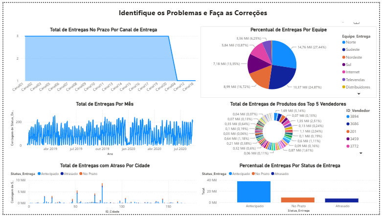
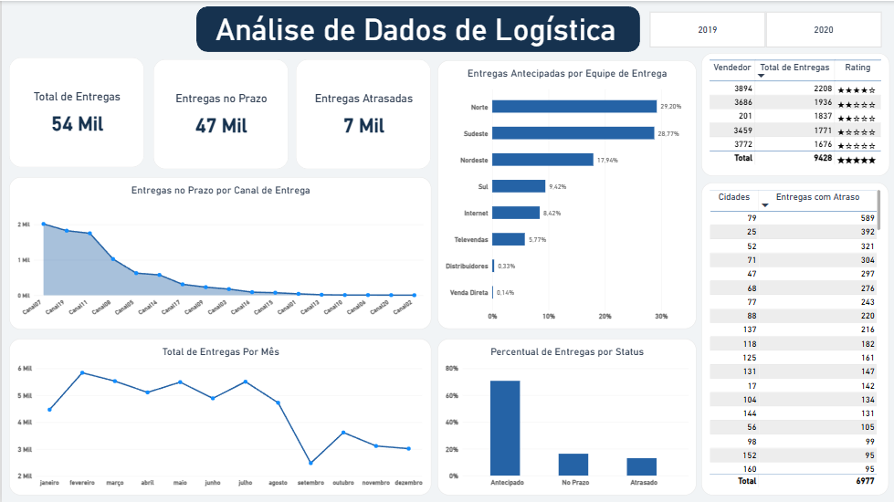

# 🚚 Análise de Dados de Logística com Power BI

## 🎯 Sobre o projeto

Projeto desenvolvido durante minha formação na **Data Science Academy (DSA)**, no curso *Microsoft Power BI para Business Intelligence e Data Science*.

O desafio proposto consistiu em revisar um dashboard de logística que apresentava problemas de visualização e análise, identificar pontos de melhoria e desenvolver uma nova versão do relatório, com o objetivo de facilitar o acompanhamento dos indicadores de entrega de uma empresa fictícia.

O projeto teve como foco a análise crítica de dashboards, a melhoria da apresentação visual dos dados e a construção de visualizações voltadas às necessidades do negócio.

**Observação:** os dados utilizados e a situação empresarial apresentada são fictícios e fazem parte do exercício proposto pela DSA.

## 🛠️ Ferramenta utilizada

- Power BI Desktop

## 📈 Indicadores e análises

O dashboard foi desenvolvido para responder às seguintes perguntas de negócio:

- **Entregas no prazo por canal de entrega:** análise da distribuição das entregas realizadas dentro do prazo entre os canais;
- **Entregas antecipadas por equipe:** análise do desempenho das equipes de entrega;
- **Total de entregas por mês:** acompanhamento da evolução mensal das entregas;
- **Entregas dos cinco principais vendedores:** comparação do volume de entregas associado aos vendedores com maior destaque;
- **Entregas com atraso por cidade:** identificação das cidades com maior quantidade de entregas atrasadas;
- **Entregas por status:** comparação entre entregas antecipadas, realizadas no prazo e atrasadas.

## 📊 Visualizações utilizadas

Foram utilizadas diferentes visualizações do Power BI para facilitar a interpretação dos dados:

- **Cards:** apresentação dos principais indicadores, como total de entregas, entregas no prazo e entregas atrasadas;
- **Gráficos de linhas e área:** análise da evolução das entregas e do comportamento dos indicadores por canal;
- **Gráfico de barras horizontais:** comparação das entregas antecipadas por equipe;
- **Gráfico de colunas:** análise do volume de entregas por mês e status;
- **Tabelas:** detalhamento dos resultados por vendedor e cidade;
- **Segmentação por ano:** filtro para explorar os dados de 2019 e 2020.

## 🔎 Melhorias realizadas

A partir da análise do dashboard original, foi desenvolvida uma nova versão com foco em organização, clareza e facilidade de interpretação.

Entre os aspectos trabalhados, destacam-se:

- Reorganização dos elementos visuais e dos indicadores;
- Maior destaque para os principais KPIs de logística;
- Melhor distribuição dos gráficos e tabelas no espaço disponível;
- Padronização visual para facilitar a leitura e a comparação dos dados;
- Utilização de indicadores resumidos para proporcionar uma visão geral do processo de entrega;
- Inclusão de filtro por ano para facilitar a exploração temporal dos resultados.

O objetivo foi tornar o relatório mais organizado e facilitar a identificação de informações relevantes para o acompanhamento das operações logísticas.

## 🖼️ Dashboard

### Dashboard original — identificação dos problemas

### Dashboard revisado — versão desenvolvida

## 🎓 Contexto

Projeto desenvolvido como parte da formação em **Análise de Dados pela Data Science Academy (DSA)**, com foco na revisão e melhoria de um dashboard de logística utilizando o Power BI.

## 👨‍💻 Autor

**Vinicius Marques**

Análise e Desenvolvimento de Sistemas | Power BI | Excel | SQL | Análise de Dados
